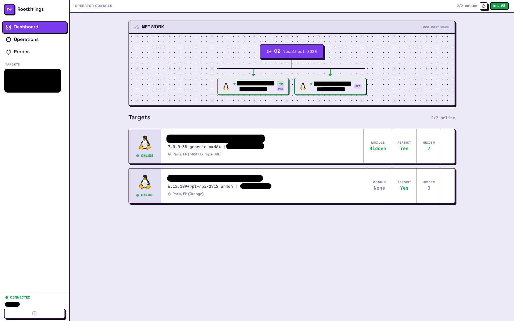

# Rootkitlings

Build a Linux kernel rootkit one mechanism at a time.

A rootkit is software that maintains privileged access to a system while hiding
its own presence.
A working rootkit solves three problems:

1. **Access**: get code running on the target, escalate to kernel level
2. **Persistence**: survive reboots without a user login or service start
3. **Concealment**: hide from every tool that reads process lists, file
   listings, network sockets, or module lists from userspace

33 exercises build all three layers from scratch.
You start with an empty kernel module and end with a remotely operated implant
that deploys itself through a real vulnerability, hides its files, processes,
and network activity, and answers commands over an encrypted channel.

Everything runs in a disposable QEMU guest.
Nothing touches the host kernel.
No previous kernel or rootkit knowledge is assumed.



## Requirements

- x86-64 Linux or macOS (Windows: use WSL2 with an Ubuntu distribution)
- Go 1.27 or newer
- Docker or Podman
- QEMU 8.0 or newer

## Quick start

```sh
./rklings setup         # check host, download VM images, generate keys
./rklings list          # show the ordered route and progress
./rklings info L00      # read the exercise contract
```

Read the exercise README, complete the declared TODOs, then:

```sh
./rklings run L00       # boot a disposable guest and operate the module
./rklings validate L00  # prove the behavior in a clean guest
```

From M02 onward, the operator and target run in separate terminals:

```sh
./rklings serve P00     # host terminal 1
./rklings run P00       # host terminal 2
```

Open `http://127.0.0.1:8080` or use the operator terminal.

## Learning path

A working rootkit solves three problems: access (get code running), persistence
(survive reboots), and concealment (hide from everything).
The course builds all three layers in order.

```text
L00-L04  Kernel foundation
   |     how modules load, own state, talk to userspace via procfs
   v
L05-L07  Access: covert command channel and escalation
   |     intercept mkdir, override process credentials
   v
L08-L09  Access: owning the interception layer
   |     kretprobes, routing commands through mkdir names
   +--> M00  Persistence: auto-load and module hiding
              |
              v
L10-L13  Concealment: filtering
   |     hide files, PIDs, content lines, network ports
   +--> M01  Milestone: a complete local rootkit
              |
              v
D00      Access: deployment against a live target
   |     initial access via CVE, privilege escalation, deploy + conceal
   v
L14-L16  Persistence: userspace agent
   |     kernel launches a Go agent, AEAD encrypted transport
   v
L17-L19  Access: remote operations
   |     command dispatch, remote shell, file transfer
   +--> M02  Milestone: complete remote operator
              |
              v
L20-L24  Concealment: tradecraft
   |     fileless loading, fileless exec, decoy routing,
   |     process masquerade, anti-forensics
   +--> M03  Milestone: ghost agent
              |
              v
           P00  Operate and verify the complete system
```

## Architecture

```text
  Target VM (QEMU guest)                        Operator host
 +-----------------------------+
 |                             |
 |  +-----------------------+  |           +---------------------+
 |  | rklings.ko            |  |           | operator server     |
 |  | kretprobes + hiding   |  |           | terminal + web UI   |
 |  +----------+------------+  |           +----------+----------+
 |             | mkdir         |                      |
 |             | syscall       |                      | commands
 |  +----------+------------+  |  WebSocket + AEAD    |
 |  | Go agent              |<---------------------+
 |  | bridge + transport    |  |
 |  +-----------------------+  |
 |                             |
 +-----------------------------+
```

The kernel module never touches the network.
The agent translates operator commands into mkdir syscalls the module intercepts
via kretprobes.

## Commands

| Command             | Purpose                                 |
| ------------------- | --------------------------------------- |
| `setup`             | Prepare dependencies, images, and keys  |
| `list`              | Show the ordered route and progress     |
| `info EXERCISE`     | Show contract, knowledge, and proofs    |
| `build EXERCISE`    | Build the declared artifacts            |
| `run EXERCISE`      | Boot a guest and apply its run contract |
| `serve EXERCISE`    | Start the host operator                 |
| `validate EXERCISE` | Verify in a clean guest, then tear down |
| `complete D00`      | Record deployment evidence              |
| `solution EXERCISE` | Show the reference solution             |
| `reset EXERCISE`    | Restore declared learner files          |
| `compile-db`        | Regenerate `compile_commands.json`      |
| `ssh NAME [USER]`   | Open a shell in a named running guest   |

## Inspirations

This course draws heavily from existing open-source LKM rootkit projects:

- [Diamorphine](https://github.com/m0nad/Diamorphine) by m0nad, the canonical
  educational LKM rootkit: signal-based toggling, module hiding, process
  concealment
- [Reptile](https://github.com/f0rb1dd3n/Reptile) by f0rb1dd3n, for its
  port-knocking backdoor and network-layer hiding techniques
- [PumaKit](https://www.elastic.co/security-labs/declawing-pumakit), analyzed by
  Elastic Security Labs, for its rmdir-based command interface and syscall
  hooking patterns
- [research-rootkit](https://github.com/NoviceLive/research-rootkit) by
  NoviceLive, a collection of rootkit technique demos with clear documentation
- Various writeups on kretprobes, ftrace hooking, and procfs/sysfs manipulation
  from the kernel security community

The exercises reimplement these techniques from scratch rather than forking any
single project.
Reading the originals alongside the exercises is encouraged.

## AI usage

AI (Claude Opus 4.6) was used during development to accelerate understanding of
kernel internals, verify mechanism correctness, and draft exercise scaffolding.
The course content, architecture decisions, and all kernel code were written and
validated, painstakingly, manually.

If you want AI assistance while working through the exercises, most modern
models will trip their anti-cyber guardrails.
I recommend these:

- **GLM 5.3 Cybersecurity**:
  - Hugging Face is your friend
- **Claude Opus 4.6**:
  - Still really good model for research
  - Will let you write malwares without a care in the world.
- **Codex Daybreak Blue/Red**:
  - Purpose made for this
